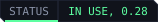

<p align="center">
  
</p>

<p align="center">
  <a href="https://edgemodders.github.io/EDGEdeck/"></a>
  
  
  
  <a href="LICENSE"></a>
</p>

A mod manager for Cyberpunk 2077 that lives inside VS Code and [REDcode](https://github.com/Edgemodders/REDcode). One list of mods, four verbs, no jargon.

EDGEdeck was called REDdeck up to 0.26.6. It is a new extension (`edgemodders.edgedeck`); nothing carries over from REDdeck, so turn every mod off and deploy in REDdeck, uninstall it, then set up EDGEdeck as new.

EDGEdeck keeps your mods in a library outside the game folder, deploys the ones you turn on with hardlinks, and undoes it just as cleanly. It recognises the frameworks (RED4ext, CET, redscript, ArchiveXL, TweakXL and friends), prepares REDmod packages, installs REDnode packages into REDnode's apps folder, writes the archive load order, and, with [REDbridge](https://github.com/Edgemodders/REDbridge) present, shows conflicts between files *inside* mod archives, which file-level managers cannot see. The name: a deck of mods, a nod to the cyberdeck, and the mods waiting "on deck" before you deploy them.

**[Read the guide](https://edgemodders.github.io/EDGEdeck/guide.html)** &middot; [Design](https://edgemodders.github.io/EDGEdeck/design.html) &middot; [Releases](https://github.com/Edgemodders/EDGEdeck/releases) &middot; [REDcode](https://github.com/Edgemodders/REDcode) &middot; [REDbridge](https://github.com/Edgemodders/REDbridge) &middot; [REDnode](https://github.com/Edgemodders/REDnode)

> [!NOTE]
> **Status: 0.20.1, in daily use on two PCs.** Add from zip, 7z, rar, folder, Nexus link or Vortex; one row per mod with a version dropdown; hardlink deploy with a manifest, undo and backups; a pending-changes list that explains every file; conflicts by order with Let X win, and inside archives through REDbridge, which Get REDbridge fetches and keeps current; the Frameworks group with the game version and a warning after a game patch; Nexus sign-in in the browser (OAuth with PKCE, or a pasted key), daily update checks, update from the row, nxm download links; a wide table page with search, facets and sizes; loadouts; a Set up group for new installs; a `edgedeck` command line with `--json`. Not on the Marketplace: install the VSIX from the [releases page](https://github.com/Edgemodders/EDGEdeck/releases). `npm run smoke` and `npm run test:ui` cover it. The [guide](https://edgemodders.github.io/EDGEdeck/guide.html) says how to use it.

## How it works

```
 Library (outside the game)            EDGEdeck (VS Code extension)           Game folder
 ┌───────────────────────────┐         ┌───────────────────────────┐         ┌──────────────────────────┐
 │ one folder per mod, laid  │  deploy │ Mods view: on/off, status │ hardlink│ archive/pc/mod/          │
 │ out exactly as it deploys │────────►│ classifier: kind + target │────────►│ r6/scripts, r6/tweaks    │
 │ mod.json, library.json    │◄────────│ deployer: manifest, undo  │◄────────│ red4ext/plugins, mods/   │
 │ downloads/ (originals)    │  undo   │ Nexus client, nxm links   │ verify  │ bin/x64/plugins/cet/mods │
 └───────────────────────────┘         └───────────────────────────┘         └──────────────────────────┘
                                       optional: REDcode (install a packed project), REDbridge (archive conflicts)
```

| You do | EDGEdeck does |
|---|---|
| **Install it** | The Set up group in the Mods view walks through the rest: find the game (Steam's library list, GOG, Epic), Get REDbridge, sign in to Nexus, take the download links, import from Vortex. Each row is a button. |
| **Open EDGEdeck** | The wide table: every mod with version, kinds, size and status in columns, a search box, status facets and Largest first, the verbs across the top. For the bigger admin jobs; the sidebar is the compact companion. |
| **Get REDbridge** | Fetches the bridge that reads inside archives, and its .NET runtime if needed, into EDGEdeck's own folder. One click, nothing to configure. |
| **Show conflicts** | One page with every conflict, who wins, and a "Let ... win" button that changes the order. The deploy toast opens it. |
| **Add** a zip, 7z, rar, folder or Nexus link | Works out what kind of mod it is and where its files go. Asks only when it cannot tell. With EDGEdeck handling nxm links, the Mod manager download button on Nexus lands the file in the library. |
| Turn a mod **on** or **off** | Nothing on disk yet. The Deploy button counts the changes waiting, and Show pending changes lists each file with its reason. |
| Pick a **version** | One row per mod; the version cell is a dropdown of what is in the library, plus Get x.y from Nexus when there is a newer file. |
| **Patch day** | The Frameworks header says "game updated to 2.31" when the game changed since the last deploy, and EDGEdeck checks the frameworks on Nexus once for that version. |
| **Deploy** | Hardlinks the enabled mods into the game, writes the load order, prepares REDmod packages, records a manifest. |
| **Remove** | Deletes the mod from the library. Deployed files come out on the next deploy. |
| **Add to REDcode project** | With a REDcode project open, copies a mod's loose files into its `source/resources` under their deploy paths, and an archive's resources, all or a pick, into `source/archive` through REDcode. **Add an archive to the REDcode project...** does the same for any `.archive` file, without adding it to the library. |
| Undo deploy | Removes every file in the manifest and nothing else. |

## Repository layout

| Path | Contents |
|---|---|
| `src/` | The extension. `core.ts` gathers the VS Code-free parts: classifier, library, deploy, extract, vortex |
| `bin/edgedeck.mjs` | The command line over the same core; `edgedeck mcp` starts the MCP server |
| `src/mcp.ts`, `src/verbs.ts` | The MCP server and the verbs it shares with the command line |
| `scripts/smoke.mjs` | End-to-end test of the core against a fake game folder |
| `images/` | Activity bar icon and extension icon |
| `docs/` | Documentation site: the guide, the design and the dev setup |
| `tools/brand/` | Generates the banner, badges and icon |

## Build

```powershell
git clone https://github.com/Edgemodders/EDGEdeck.git
cd EDGEdeck
npm install
npm run build       # or: npm run watch
npm run smoke       # classify, add, deploy, undo against a temp folder
```

Open the folder in VS Code and press F5 to run the extension in a second window. Details in the [setup guide](https://edgemodders.github.io/EDGEdeck/dev-setup.html).

## Command line and MCP

```
node bin/edgedeck.mjs list                      # what is in the library and its status
node bin/edgedeck.mjs add "C:\Downloads\Mod.zip" --name "My Mod"
node bin/edgedeck.mjs install-project "C:\Mods\MyMod\MyMod.cpmodproj"   # a packed project, added or refreshed
node bin/edgedeck.mjs on my-mod && node bin/edgedeck.mjs deploy
node bin/edgedeck.mjs conflicts --json          # every command prints JSON with --json
```

`--library` and `--game` override the folders. The library's JSON files are the only state, so an assistant can read them directly and use the command line to act.

On npm as [`@edgemodders/edgedeck-mcp`](https://www.npmjs.com/package/@edgemodders/edgedeck-mcp): `npx -y @edgemodders/edgedeck-mcp` (server) and `edgedeck` (CLI), published with every release at the extension's version; `scripts/npm-package.mjs` assembles it from the build, the README is `docs/npm.md`.

The same verbs are MCP tools: `node dist/mcp.js --library <folder> --game <folder>` serves `edgedeck_list`, `edgedeck_mod`, `edgedeck_add`, `edgedeck_install_project`, `edgedeck_turn`, `edgedeck_move`, `edgedeck_remove`, `edgedeck_pending`, `edgedeck_deploy`, `edgedeck_undo`, `edgedeck_changes`, `edgedeck_conflicts`, `edgedeck_loadout` and `edgedeck_vortex` over stdio. VS Code 1.101 and later picks the server up from the extension for the agents it hosts; **EDGEdeck: Connect an assistant (MCP)...** copies the `claude mcp add` line for Claude Code. The Mods view follows what an assistant changes.

## Roadmap

- **M0 Decide.** Name, repository, the word list, the extension scaffold.
- **M1 Library.** Add from archives and folders, the library layout, hardlink deploy with manifest and undo, changes made outside EDGEdeck, Vortex detection and import. Done.
- **M2 Kinds.** Frameworks group with game version check, REDmod packages, file and archive conflicts with reorder. Done.
- **M3 Nexus.** Sign in (OAuth with PKCE in the browser once Nexus assigns the client id, a pasted key until then and as a choice always), mod metadata, updates, nxm links. Done.
- **M4 Loop.** Install and test a REDcode project with one click (EDGEdeck side done; the REDcode side is in that repo). REDnode packages as a mod kind.
- **M5 Share.** Loadouts, the `edgedeck` CLI and the MCP server are done. No Marketplace publishing for now; releases carry the VSIX.

## Relation to Vortex

Vortex works and supports two hundred games. EDGEdeck supports one, so it can leave out profiles, activators, phases and the thirty-odd installer rules that make Vortex feel heavy for Cyberpunk. It keeps the parts that are unavoidable: a library outside the game, a deployment manifest, detection of changes made outside the manager, load order, conflicts and Nexus links. EDGEdeck refuses to deploy while Vortex manages the same game folder, and can import Vortex's library.

## Legal

MIT. This repository contains no game files, no mod files and no data extracted from the game. Single-player modding only. Nexus Mods is used through its public API under its acceptable use policy. REDmod, REDengine and Cyberpunk 2077 are CD PROJEKT's. A cyberdeck is theirs too; a deck of mods is ours.

## License

[MIT](LICENSE)
